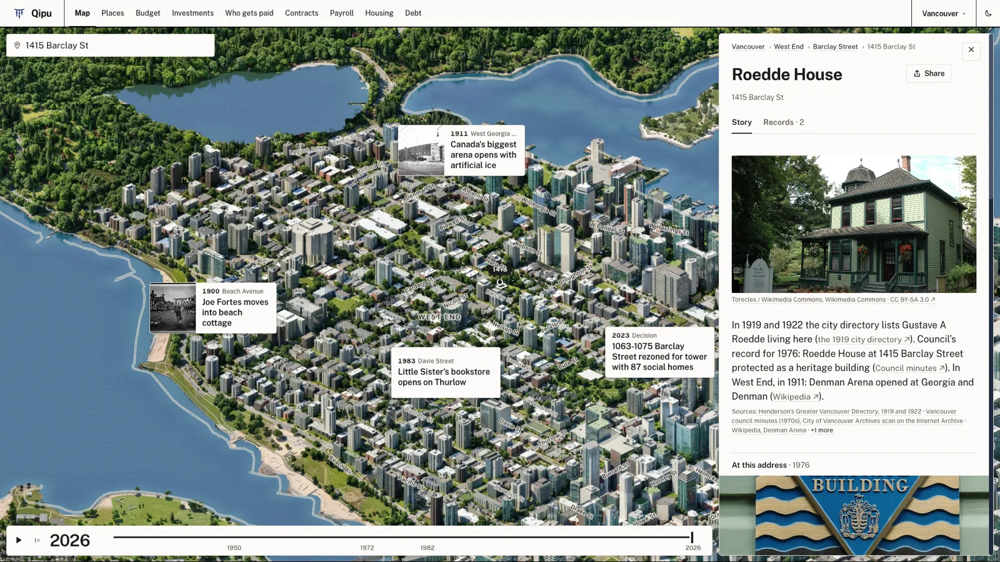

# qipu-vancouver

[](https://github.com/AbstractsMachine/qipu-vancouver/actions/workflows/ci.yml)

City councils have kept minutes for more than a century. Many of them have been scanned and put on the Internet Archive.
The minutes answer questions people still ask. Who approved this building? When was this street widened? How did the vote go?
But a scan is hard to search, and its OCR text is harder still.

This repository turns those scans into facts anyone can check. It shows them on a painted map of the city, year by year.
How often the facts are wrong, and how that was measured, is in [docs/accuracy.md](docs/accuracy.md).

Built for the Internet Archive and Futureproof Festival Fellowship.

```
scanned minutes on archive.org ──▶ decision records ──▶ records kept current ──┐
                                   packages/records     packages/updates       ├──▶ map viewer
open city data ──────────────────▶ painted map tiles, one set per year ────────┘    packages/viewer
                                   packages/map-pipeline
```



*Vancouver today on qipu.org: the painted city, and what council decided at each address.*

**Live demo:** https://www.qipu.org/vancouver (going live 27 Oct), Vancouver City Council decisions from the 1970s on, on the map.

| package | what it does | language |
|---|---|---|
| [`packages/records`](packages/records) | reads each scanned page with a language model. Plain code then checks every decision. The quote must be on the page. The date comes from the minutes. Private names in sensitive matters are withheld. Each record links to its page in the archive.org viewer | Python 3.11+, standard library only |
| [`packages/updates`](packages/updates) | keeps the records current on a schedule. It finds new and re-scanned minutes and extracts only those. It checks the release against the pages with its gates, which are automatic checks that must all pass before anything is published. It publishes the release as a new version and rolls back in one command. It opens an issue when a run fails | Python 3.11+, depends on records |
| [`packages/map-pipeline`](packages/map-pipeline) | turns open city data into the painted map that plays through time. The steps are a 3D scene of the city, a Blender render, an AI paint pass, the eras and the tiles. An era is the same scene as it stood in an earlier year. Date maps are images that record in which year each pixel changes | Python 3.12+ (numpy, Pillow, shapely). Blender and FLUX.2 klein on a GPU; FLUX.2 klein is an open image model that paints the map |
| [`packages/viewer`](packages/viewer) | the web map: painted tiles, a year slider, and the records of each place | TypeScript, React, Leaflet |

## Quickstart

Every package runs on the bundled Vancouver sample with no API key and no GPU. You need `make` and Node 20 or newer.
You also need Python 3.11 or newer for `records` and `updates`, and Python 3.12 or newer for `map-pipeline`.

```sh
git clone https://github.com/AbstractsMachine/qipu-vancouver && cd qipu-vancouver

make -C packages/records demo                 # read 9 pages with recorded model answers, check them: build/demo/
make -C packages/updates install demo         # two scheduled runs a week apart; the second processes only the new meeting
make -C packages/map-pipeline install sample  # every map stage on a CPU: build/sample/release/sample/ (about three minutes, plus the first install of numpy, shapely and Pillow)
make -C packages/viewer install demo          # the web map at http://localhost:5173 (Ctrl-C to stop)
```


*The viewer in this repo, with the bundled demo records.*

To run every package's lint, type checks and tests with coverage, as CI does:

```sh
make install check
```

[`examples/vancouver`](examples/vancouver) explains the sample, and each package's README says how to run it on more data.

To change something, [CONTRIBUTING.md](CONTRIBUTING.md) says where each part lives, how to run one package's tests and how to add a regression fixture.

## Documentation

- [docs/architecture.md](docs/architecture.md): how the packages fit together, and what passes between them (one page)
- [docs/data-model.md](docs/data-model.md): every field of a decision record
- [docs/tiles-format.md](docs/tiles-format.md): the tile pyramid and manifest the map pipeline writes and the viewer reads
- [docs/accuracy.md](docs/accuracy.md): how often the records are wrong, how that was measured, and what the numbers do not say
- [docs/privacy.md](docs/privacy.md): which names are withheld, and why
- [docs/updates.md](docs/updates.md): the scheduled refresh: how it runs, how to add a source, pause it or roll back

## Contributing

Each package has its own Makefile with the same targets (`install`, `check`, `test`, `e2e`, `demo`, `build`). The root
Makefile runs a target in every package. CI runs a package's jobs when that package changes. It also runs the pre-commit hooks,
and it scans the full history for secrets on every push. The one required check is `ci-ok`. [CONTRIBUTING.md](CONTRIBUTING.md)
has the setup, the conventions and how to report a wrong record.

## Licences

Code is under the [Apache License 2.0](LICENSE). Data the code produces, and the sample data in `examples/`, are dedicated to the
public domain under [CC0 1.0](LICENSE-DATA). The exception is the third-party open data that [LICENSE-DATA](LICENSE-DATA) lists
with its own terms: City of Vancouver, LidarBC, Natural Resources Canada and OpenStreetMap. [NOTICE](NOTICE) carries their
attribution lines.

## Credits

The scans and their OCR are the work of the [Internet Archive](https://archive.org) and the archives and libraries that
digitised the records. These are the [City of Vancouver Archives](https://searcharchives.vancouver.ca) and the
[San Francisco Public Library](https://sfpl.org). The Vancouver Archives digitised its 1970s minutes with funding from the
British Columbia History Digitization Program at the University of British Columbia.

Addresses and neighbourhoods come from the [City of Vancouver Open Data Portal](https://opendata.vancouver.ca). The viewer draws
its map with [Leaflet](https://leafletjs.com). The records package's map preview uses [MapLibre GL JS](https://maplibre.org).
The sample data includes [OpenStreetMap](https://www.openstreetmap.org/copyright) data.
