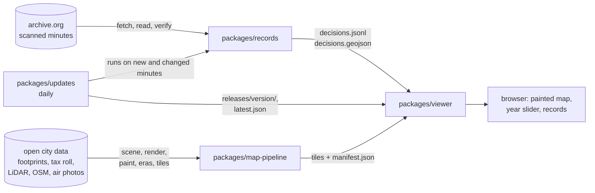

# Architecture

qipu-vancouver is four packages that hand files to each other. What passes between them is a folder of plain files with a
documented format, so each package can be run, tested and replaced on its own. The one import between packages is
packages/updates, which runs packages/records on a schedule and publishes the same files.

## packages/records

From the OCR of a scanned page to checked decision records. A language model reads each page and lists its decisions; plain,
tested code then decides what is published: the model's quote must be on the page, the date is read from the minutes, the
outcome follows fixed rules, private names in sensitive matters are withheld, and every record links to its page in the
archive.org viewer. [packages/records/ARCHITECTURE.md](../packages/records/ARCHITECTURE.md) walks through each step.

Output: `decisions.jsonl` (one record per decision, see [data-model.md](data-model.md)) and `decisions.geojson` (one point per
placed place).

## packages/updates

Keeps the records current. Every day it lists the source (an archive.org collection, or a Legistar calendar), runs records on
only the new and changed meetings, checks the whole release against the page text, and publishes it as a new version with a
manifest of where every record came from. Earlier versions stay, so a rollback is one command. See [updates.md](updates.md).

Output: `releases/<version>/` holding the same `decisions.jsonl` and `decisions.geojson`, plus `manifest.json`, and a
`latest.json` that names the published version.

## packages/map-pipeline

From open data about the city to a painted bird's-eye map that plays through time. It builds a 3D scene of the city today
from building footprints, tax-roll years, LiDAR heights, streets, trees and the shoreline; works out what stood in each past
year; renders every year in Blender through one fixed camera; has an image model repaint each render as an aerial
photograph, tile by tile, with checks that it invented or removed nothing; and cuts the results into tile pyramids with
"date maps" that say when each pixel changes. Each stage reads the previous stage's files and can run on its
own; on a laptop, stand-ins replace Blender and the image model. [packages/map-pipeline/ARCHITECTURE.md](../packages/map-pipeline/ARCHITECTURE.md)
has the stages and the reasons behind them.

Output: a release folder of WebP tiles per era and a `manifest.json`, in the format of [tiles-format.md](tiles-format.md).

## packages/viewer

The web map. It draws the painted tiles for the year on the slider and shows the decision records of the place under the
cursor, each with its quote and a link to the scanned page. It is a React component with no server of its own, plus a demo
app. [packages/viewer/ARCHITECTURE.md](../packages/viewer/ARCHITECTURE.md) walks through its modules.

## Boundaries

- The only contracts between packages are [data-model.md](data-model.md) and [tiles-format.md](tiles-format.md). A change to
  either is a change to every package that reads it, in the same pull request.
- Each package owns its language, dependencies, tests and Makefile. Shared lint and format settings live at the root
  (`ruff.toml`, `.prettierrc.json`, `eslint.config.mjs`, `.editorconfig`).
- The sample in [examples/vancouver](../examples/vancouver) is the common test bed: every package's demo runs on it.
- Network access sits behind one small module per package (`fetch/http.py`, `sources/http.py`, `ingest/http.py`), so
  tests replace it and run offline; every Python test suite fails a test that tries to reach another host. They share
  one retry rule: a dropped connection, a timeout, a 5xx, a 408 or a 429 is retried with a growing pause, and any other
  4xx is raised at once. packages/updates calls qipu-records' `fetch/http.py`; map-pipeline, which does not depend on
  records, has its own copy of the rule.
