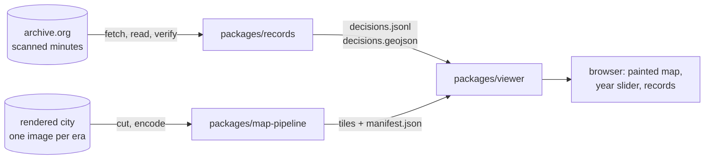

# Architecture

qipu-open is three packages that hand files to each other. None of them imports another: what passes between them is a folder
of plain files with a documented format, so each package can be run, tested and replaced on its own.

## packages/records

From the OCR of a scanned page to checked decision records. A language model reads each page and lists its decisions; plain,
tested code then decides what is published: the model's quote must be on the page, the date is read from the minutes, the
outcome follows fixed rules, private names in sensitive matters are withheld, and every record links to its page in the
archive.org viewer. [packages/records/ARCHITECTURE.md](../packages/records/ARCHITECTURE.md) walks through each step.

Output: `decisions.jsonl` (one record per decision, see [data-model.md](data-model.md)) and `decisions.geojson` (one point per
placed place).

## packages/map-pipeline

From a rendered image of the city to a tile pyramid the browser can stream, one pyramid per era, with a manifest that says
which eras exist and how to address their tiles. Format: [tiles-format.md](tiles-format.md).

## packages/viewer

The web map. It draws the painted tiles for the year on the slider and shows the decision records of the place under the
cursor, each with its quote and a link to the scanned page.

## Boundaries

- The only contracts between packages are [data-model.md](data-model.md) and [tiles-format.md](tiles-format.md). A change to
  either is a change to every package that reads it, in the same pull request.
- Each package owns its language, dependencies, tests and Makefile. Shared lint and format settings live at the root
  (`ruff.toml`, `.prettierrc.json`, `eslint.config.mjs`, `.editorconfig`).
- The sample in [examples/vancouver](../examples/vancouver) is the common test bed: every package's demo runs on it.
