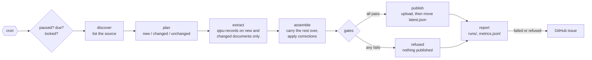

# Keeping the records up to date

Councils keep meeting, and archive.org keeps adding and re-scanning minutes. `packages/updates` runs on a schedule, finds what
changed since the last release, extracts records from only that, checks the whole release, and publishes it as a new version.
Every earlier version stays, so going back is one command.



## A run

**Discover.** The source lists what it holds today. For Vancouver that is the archive.org collection
`cityofvancouvercouncilminutes`, read through the scrape API; an item's fingerprint is its last update time, so a re-scan or
new OCR shows up as a change. If the listing has fewer than half the documents of the last release, the run stops: a broken
listing must never look like a mass deletion. A source that only shows a window (Legistar shows two months) is exempt, and
documents that have left its window stay in the release.

**Plan.** Each listed document is new, changed or unchanged against the manifest of the published release. A document is also
changed when its build key differs: the qipu-records version, the prompt, the model, the gazetteer or the privacy cutoff year.
So upgrading the extractor rebuilds everything, and so does New Year, when one more year of records leaves the embargo.

**Extract.** Each new or changed document is staged in the working copy (a qipu-records collection folder per document).
Its pages are fetched, or, when only the build key changed, taken from the copy already there. Readings are kept for every
page whose text did not change and that was read with the same prompt and model; only the other pages go to the model,
within a page budget per run (`max_pages_per_run`). A document not finished when the budget runs out stays staged for the
next run, which continues where this one stopped, while the release keeps its previous records and the pages they were
read from. A finished document replaces its previous copy, qipu-records builds its records, and each one is stamped with
its provenance.

**Assemble.** The new release folder takes the rebuilt documents, copies the others from the published release, and applies
the corrections file (see below). Records of unchanged documents are carried over as they were published.

**Gates.** Every gate reads the release as it will be published and works from the page text, not from flags the extractor
set:

| gate | fails when |
|---|---|
| `quote_on_page` | a record's quote is not on its page or the page before (a withheld name is skipped over) |
| `date_from_header` | a record's date differs from the one the page's running head or meeting opening gives, read again |
| `proposed_vs_decided` | the stage or outcome does not follow from the action (a first reading shown as passed), or a referred rezoning is shown as rezoned |
| `privacy_leak` | a sensitive record under the embargo still shows a private person's name |
| `over_redaction` | a name is withheld where the rule keeps it: a record that is not sensitive or is older than the embargo, the record's source, action or outcome, a mover, seconder or voter, a name after an official title or a delegation word, or before a firm, organisation or place word |
| `no_shrink` | the release has fewer than half the records of the last one |
| `files_intact` | a file is empty or zero-filled (what a disk that drops mid-write leaves) |
| `corrections_applied` | a correction matched more rows than it allows, or none when it expected some |

Each gate allows 0 findings unless the config's `[gates]` table says otherwise. One failed gate stops the publish, and the
draft stays in the working copy to look at.

**Publish.** The release folder is uploaded; once every file the manifest lists is there, `latest.json` is moved to it.
Readers follow `latest.json`, so they see either the old release or the new one, never half of one.

**Report.** Every run, whatever happened, writes `runs/<run id>.json` and a line in `metrics.jsonl`: what was listed, what
was built, pages read, readings reused, records, rejected items, each gate's result, and the outcome:

| outcome | meaning |
|---|---|
| `published` | a new release is live |
| `no-change` | nothing new or changed; nothing published |
| `refused` | a gate failed; nothing published (exit code 3) |
| `failed` | the run broke, for example a source that did not answer (exit code 1) |
| `publish-paused` | built and checked, not published because publishing is paused |
| `dry-run` | built and checked, nothing written to the store |
| `paused`, `not-due`, `busy` | skipped: paused entirely, checked recently enough, or another run holds the lock |

## A release

```
latest.json                   {"version", "manifest_sha256", "published", "previous"}
history.jsonl                 every publish, rollback, pause and resume
releases/2026-10-26.1/
  manifest.json               parent release, run id, extractor version, prompt, model, config hash, the fingerprint and
                              build key of every document, sha256 of every file, corrections applied, gate results
  records/<item>.jsonl        one document's records
  decisions.jsonl             all records (format: data-model.md)
  decisions.geojson           the placed ones, for the map
  withdrawn.jsonl             records removed by a correction, with the rule and its reason
runs/<run id>.json            what each run did
metrics.jsonl                 one line per run
control/                      pause and lock markers
```

Each record says where it came from: `source` (the archive.org item, the OCR page and its viewer link), `reading` (model and
prompt version) and `provenance` (the run that built it, the document's address and fingerprint, and the sha256 of the page
text it was read from).

## Running it

```sh
make -C packages/updates install
make -C packages/updates demo
```

The demo plays two scheduled runs a week apart on the Vancouver sample. The first finds the 1970 meeting and publishes it;
the second finds the 1974 meeting, reads only its six pages, and publishes a release in which the 1970 records are carried
over unchanged. `examples/vancouver/updates/arrivals.json` is what makes the sample arrive in two steps.

For the real collection, change the config's `[source]` to `kind = "archive"` with
`collection = "cityofvancouvercouncilminutes"`, the `[reader]` to `kind = "anthropic"` (it reads `ANTHROPIC_API_KEY`), and
`[publish]` to an rclone remote. The first run reads the whole collection, so set `max_pages_per_run` to what you are willing
to spend in a day and let it catch up over several runs.

The workflow `.github/workflows/updates.yml` runs the loop every day at 14:17 UTC on the sample, keeps its store between runs
in the Actions cache, and uploads the store as an artifact. It needs no secrets.

## Adding a source

A source answers two questions:

```python
class Source(Protocol):
    complete: bool                                              # False when the listing is a window
    def discover(self, as_of: dt.date) -> list[Document]: ...   # what exists today
    def content(self, doc: Document) -> Content: ...            # one document's page texts
```

`Document.fingerprint` must change whenever the text may have changed (an update time, an ETag, a hash of the file). Then:

- write it in `sources/` with its parsing as pure functions, tested on a saved page in `tests/fixtures`;
- add its `kind` to `wiring.make_source`;
- write a config: `examples/san_francisco/updates/updates.toml` reads the San Francisco Board of Supervisors' minutes from
  its Legistar calendar (`sources/legistar.py`), one document per meeting, fingerprinted by the minutes PDF.

Nothing else changes: planning, extraction, gates and publishing work on documents, whatever their source.

## Pausing

| to | do |
|---|---|
| stop publishing, keep building and checking | `qipu-updates pause --config C --scope publish --reason "..."`, or set the repository variable `UPDATES_PUBLISH` to `off` |
| skip runs entirely | `qipu-updates pause --config C --scope all --reason "..."` |
| stop the schedule | `gh workflow disable updates.yml` |
| undo a pause | `qipu-updates resume --config C` |

`qipu-updates status --config C` shows what is published, whether it is paused, and the last runs.

## Rolling back

```sh
qipu-updates releases --config C                      # * marks the published one
qipu-updates rollback --config C --reason "wrong dates in the 1974 minutes"
qipu-updates rollback --config C --to 2026-10-19.1 --reason "..."
```

With no `--to`, it goes to the newest earlier release that was published. A rollback moves `latest.json` and deletes nothing,
so it can be undone the same way. It also pauses publishing, so the next scheduled run does not publish the same content
again; fix the cause (a correction, a config change, a new extractor version), then `resume`.

## Corrections

A fix found by a person is a line in `corrections.jsonl`, applied to every release from then on:

```json
{"rule_id": "c1", "action": "drop", "where": {"id": "19740219:3/2"}, "reason": "not a decision", "author": "...",
 "at": "2026-10-26", "evidence": "https://archive.org/details/19740219/page/n5", "min_rows": 1, "max_rows": 1}
{"rule_id": "c2", "action": "replace_text", "find": "Grandvlew", "replace": "Grandview", "fields": ["summary"], "max_rows": 20}
```

A rule that matches more than `max_rows` (default 1) changes nothing and fails the release; one that matches fewer than
`min_rows` fails it as stale, unless an earlier release already applied it. Dropped records are listed in `withdrawn.jsonl`.

## When a run fails

The workflow's last step runs `qipu-updates alert` when a scheduled run fails or is refused: it opens an issue titled
"Scheduled update failed: vancouver", labelled `workflow-failure`, with the run's report and a link to the log, or comments
on that issue if it is still open. Close it once the run is green again.

## Limits

- The lock is a marker in the store with an expiry, read and then written. GitHub's concurrency group keeps scheduled runs
  apart; the lock also stops a manual run from another machine, but two runs starting within a few seconds of each other
  could both take it.
- `max_pages_per_run` counts every page that may have been sent, including pages whose answer was unusable. Such a page is
  sent again on the next run, so a page that never gets a usable answer keeps its document unfinished; it shows in every
  run's report under "left for the next run".
- Every release is a full folder. For Vancouver's 1,116 meetings that is tens of megabytes a release; old releases are
  kept until someone deletes them.
- Gates that need the page text skip records carried over from a document whose pages are not in the working copy (they
  passed when they were built). Keep the working copy between runs, as the workflow does.
- The San Francisco config has been tested against a saved calendar page, not run end to end: the San Francisco prompt was
  written for the printed Journal of Proceedings, not for today's minutes.
