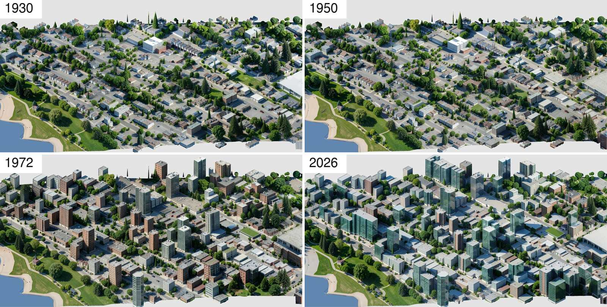
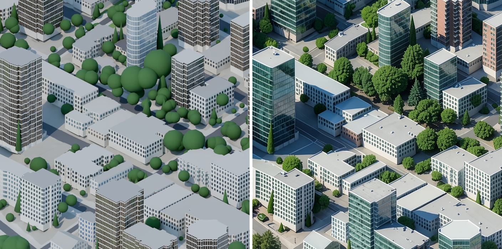

# map-pipeline

The pipeline behind qipu's painted city maps: it turns open data about a city into a bird's-eye picture of it that you
can play through time, from 1930 to today, one building at a time.

It reads building footprints, tax-roll years, LiDAR heights, streets, trees, parks and the shoreline; builds a 3D scene of
the city as it stands today; works out which buildings stood in each past year; renders every year with Blender through
one fixed oblique camera; has an image model repaint each render as an aerial photograph, tile by tile; and cuts the
results into map tiles with "date maps" that say when each pixel changes. This is the code that makes the map at
[qipu.org/vancouver](https://www.qipu.org/vancouver), curated: the stages and rules that made it, without the
experiments around them.



*The sample area, from 1139 Pendrell Street to English Bay, in four years, from the full chain on one rented GPU (Blender,
then FLUX.2 klein 4B; about an hour and $0.62 of card time). Houses in 1930 and 1950 stand where the 1950 air photos show
built-up lots; the brick mid-rises arrive in the 1960s and the glass towers later, each in the year the tax roll gives it.*



*Render and paint, side by side at full resolution. The render decides what is there: footprints, heights, roofs, which
trees. The model only repaints its surface.*

On a laptop, `make sample` runs the same chain with stand-ins for the GPU stages, and draws this:


## Quickstart

You need Python 3.12 or newer (numpy 2.5 needs it).

```sh
make install    # a .venv with the package and the development tools
make sample     # every stage on the bundled West End sample, CPU only, about three minutes
```

`make sample` writes a complete release to `build/sample/release/sample/`: `manifest.json`, today's tiles, four past
years and the date maps between them, in the format the viewer reads ([docs/tiles-format.md](../../docs/tiles-format.md)).
It uses no network and no GPU: the two expensive stages run with stand-ins that write the same files (a small numpy
rasteriser for Blender, the render itself for the painted image). [`packages/viewer`](../viewer) shows the release.

With Blender and a CUDA GPU, the same command runs the real chain:

```sh
make sample-gpu   # Blender 4.2+ on PATH and a 24 GB+ CUDA GPU; see docs/render.md and docs/paint.md
```

## The stages

| stage | what it does | docs |
|---|---|---|
| `ingest` | fetches City of Vancouver open data, OpenStreetMap and LidarBC 2025 grids for an area, and normalises them | [ingest](docs/ingest.md) |
| `scene` | heights from LiDAR, roof forms, Vancouver building types, trees, water and terrain: today's 3D scene | [scene](docs/scene.md) |
| `eras scene` | the scene of each past year: what stood then, by sourced rules and stated conventions | [eras](docs/eras.md) |
| `render` | each year through the map camera, in frames: a beauty pass, a surface-class pass and a building-id pass | [render](docs/render.md) |
| `paint` | FLUX.2 klein repaints the render tile by tile on a world grid, with guards against invented or lost buildings | [paint](docs/paint.md) |
| `eras layers` | what changed from today in each year, and when each pixel changes between two years | [eras](docs/eras.md) |
| `tiles` | WebP tile pyramids of today and of each past year | [tiles](docs/tiles.md) |
| `publish` | the manifest, then an idempotent upload to S3-compatible storage (Cloudflare R2 for qipu.org) | [publish](docs/publish.md) |

Each stage is a sub-command (`qipu-map scene --city vancouver --area west-end`), reads the previous stage's files, and
skips its work when its inputs have not changed. [ARCHITECTURE.md](ARCHITECTURE.md) has the diagram and the reasons
behind the design.

## Two ideas that matter

**The 3D scene decides what is there; the model only paints it.** Asked for "Vancouver in 1950", an image model draws a
plausible city, not the one that stood there. So every building, its height and its year come from data, and the model
repaints a render it is given, one 1024 px tile at a time, with the render's water put back and each tile checked for a
building that vanished or a structure that appeared on open ground.

**A past year is today minus what was not built yet, plus what the record says stood.** Each building carries its year
and where the year comes from: the tax roll, a permit, OpenStreetMap, or a stated convention. Lots whose building is
newer get period houses only where the 1950 and 1959 federal air photos show built-up ground. Each rule says whether it
is sourced or a convention, and a convention never contradicts a record.

## Costs

Measured on the runs that made the qipu.org maps (rented GPUs, 24 September to 25 October 2026), per km² and per year
of map at their resolution:

| | per km² | Vancouver (115 km²), one year |
|---|---|---|
| Blender render (A40, about $0.49/h) | about $0.55 | $60–70, 3–4 hours on 8 cards |
| AI paint (FLUX.2 klein 9B, RTX 5090) | $0.50–1.65 | $60–190 |
| idle cards, retries, transfers | +50–100 % | |

At this repository's default resolution (0.25 m/px, about a fifth of the tiles) the paint costs about $0.25/km². The
sample area is 0.5 km²: its GPU run costs well under a dollar. Everything else runs on a laptop in minutes.

## Tests

```sh
make check    # ruff, mypy --strict, unit and integration tests with coverage (fails under 85 %)
make e2e      # the whole sample chain, as `make sample`, with checks on the release
```

496 unit and integration tests run in about 40 seconds, with 98 % line coverage. The integration tests run the stages
together on a corner of the sample; the end-to-end test runs the whole sample. Blender and the image model are not run
in CI: their drivers are tested with the subprocess and the model mocked, and the stand-ins exercise everything after them.

## Limitations

- **The tax roll only knows today's buildings.** A building demolished before the open data was published is missing
  from every past year unless a stand-in covers its lot. Stand-ins are generic houses on 10 m lots, placed where the air
  photos show built-up ground; they are not the actual houses.
- **Undated changes are spread, not known.** Ground, streets and paint that differ between two years with no record get a
  smooth dissolve across the segment.
- **Trees are today's trees** in every year: the tree register no longer publishes planting dates.
- **Landmarks are boxes.** The qipu.org map hand-models landmarks (Canada Place, the bridges, Harbour Centre); this repository
  leaves them out.
- **The paint has a look of its own.** FLUX.2 klein 4B makes most towers green reflective glass even when asked for
  opaque glass, so today's West End reads greener and glassier than it is. The live map uses the larger klein 9B.
- **The painter can still invent.** The guards catch most invented structures and vanished buildings and re-roll the
  tile; what they miss shows on the map. The thresholds were calibrated at the qipu.org map's finer resolution.
- **One area at a time.** Every stage holds its canvas in memory, which is fine for a district and too much for a whole
  city at full resolution; a city is cut into areas.

## Data and licences

The code is under the [Apache License 2.0](LICENSE). The sample in [`examples/vancouver/west-end/`](../../examples/vancouver/west-end) keeps its sources'
licences, listed file by file in its [README](../../examples/vancouver/west-end/README.md):

- City of Vancouver Open Data (footprints, parcels, tax roll, trees, parks, streets, shoreline): Open Government Licence – Vancouver.
- LidarBC 2025 surface and terrain models: Open Government Licence – British Columbia.
- 1950 and 1959 air-photo built-up masks, derived from the National Air Photo Library mosaics: Open Government Licence – Canada.
- OpenStreetMap: © OpenStreetMap contributors, ODbL.

The default painter is FLUX.2 klein 4B (Apache 2.0). The qipu.org map was painted with FLUX.2 klein 9B, which is under a
non-commercial licence; see [docs/paint.md](docs/paint.md).

## Credits

Built for [qipu](https://www.qipu.org), which publishes San Francisco's and Vancouver's public records as open data.
Thanks to the City of Vancouver, GeoBC, Natural Resources Canada, the OpenStreetMap community, the Blender Foundation and
Black Forest Labs, whose open data and tools this pipeline stands on.
