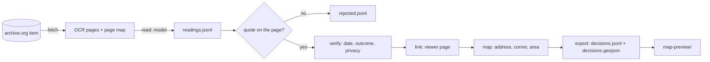

# Architecture

qipu-records has one job: turn the OCR text of scanned minutes into decision records that anyone can check against the scan.
A language model does the reading, because minutes are too varied for rules. Everything else is plain code, because the checks
have to be predictable and testable. This page walks through the pipeline in the order the data moves.

## The pipeline



## Layout

The package is split by stage, in the order the data moves. Each stage is a small package with modules of one job each.

```
src/qipu_records/
  fetch/      archive.py: items, metadata and OCR pages from archive.org (cached, polite); run.py: the fetch step
  read/       schema.py: the JSON the model answers with; readers.py: Anthropic, OpenAI-compatible, replay;
              prompts/: each city's system prompt as used in the published runs; run.py: the read step (capped, resumable)
  verify/     quotes.py: the quote is on the page; dates.py: meeting date from the headers;
              outcomes.py: stage, outcome and the rezoning rule; privacy.py: names withheld in sensitive matters
  link/       pagemap.py: OCR page -> page in the archive.org viewer
  map/        gazetteer.py: places matched to the city's addresses, corners and neighbourhoods
  export/     records.py: the published record; geojson.py: the map layer
  pipeline.py runs verify, link, map and export over a collection
  cities.py   what changes per city: prompt, currency, embargo, collection
  collection.py  the files of a run
  cli.py      the qipu-records command
map-preview/  a static map of decisions.geojson (MapLibre GL JS)
examples/     a script to read one meeting, and one to query the records
tests/
  unit/         one folder per stage, mirroring src/
  integration/  stages working together on the sample and on saved archive.org responses
  e2e/          make demo, then the map page in a headless browser
  fixtures/     trimmed copies of real archive.org responses for one meeting
```

The package has no runtime dependencies. The Anthropic and OpenAI clients are optional extras, loaded only by the reader that
needs them.

## The collection folder

A run lives in one folder of plain JSON files (see `collection.py`). `fetch` writes the items, pages and page maps; `read`
appends one line per page to `readings.jsonl`; `build` reads all of them and writes the records. Each step can be re-run: items
already fetched and pages already read are skipped, and `build` always rebuilds its output from scratch. Keeping the model's raw
answers apart from the records means the checks can change without paying for the reading again.

## Reading

Each page goes to the model with the city's system prompt, the last 2,500 characters of the previous page (an item's heading
is often on one page and its vote on the next) and the page itself, cut at 9,000 characters. The answer must match
`schema.RESPONSE`, which the API enforces through structured output. Each answer is stored with the model name and a hash of
the system prompt, so every record can be traced to the exact prompt that produced it. The prompts in `prompts/` are the ones
used for the published runs; a test pins their hashes.

The reader is an interface with one method, `read(page_id, system_prompt, user_message)`. `ReplayReader` answers from a file,
which is how `make demo` and the tests run the real pipeline without a key.

## Checking

`pipeline.py` takes each item the model listed and applies, in order:

**Quote on the page.** The model must give the first words of the item's heading, copied from the OCR. `verify.quotes.locate` looks
for them after folding case and whitespace, and falls back to a fuzzy match of the opening words when OCR noise gets in the
way. An item whose quote is on neither this page nor the previous one is not published; it goes to `rejected.jsonl`. This is
the main defence against invented items.

**Meeting date.** The model is not asked for the date. `verify/dates.py` reads it from the minutes: a meeting that opens on the page,
else the running head at the top of the page, else the meeting in progress from the page before, else the item's catalogue
date. A printed weekday must agree with the date, so an OCR slip in a digit dates nothing rather than the wrong day. When a
meeting opens part way down a page, items above the opening keep the earlier meeting. Wrong dates were the most common flaw
in published facts before this rule.

**Outcome.** The model reports the last action on the item. `verify/outcomes.py` maps it to a stage and an outcome, and only a final
act counts as passed: a first reading or a referral is pending. Zoning fields become "rezoned" only for a by-law or resolution
finally passed or adopted; anything else is "rezoning proposed", and a renamed street is no zoning change.

**Privacy.** For a record inside the city's embargo whose matter is sensitive, `verify/privacy.py` withholds the names of private
people from the quote, the summary, the parties and the places. Officials are recognised from the record itself (mover,
seconder, roll call, names next to a role on the page) and organisations from the words in their names. See
[docs/privacy.md](../../docs/privacy.md).

**Place.** `map/gazetteer.py` matches an address, a corner or a neighbourhood exactly against the city's open data. A street alone is
not placed: a point in the middle of a long street would mislead.

**Page link.** archive.org numbers OCR pages by scan image, but its viewer hides some images (colour cards, blank covers), so
the two numberings drift apart. `link/pagemap.py` rebuilds the viewer's numbering from archive.org's own two lists, the images in the
page-image zip and the images the viewer shows. When they disagree the record gets no link rather than a wrong one.

## Output

`decisions.jsonl` has one record per decision ([docs/data-model.md](../../docs/data-model.md)). `decisions.geojson` has one point per
placed place, for the viewer or any GIS tool. `summary.json` counts what passed each check, which is the first thing to look
at after a run.

## Choices worth knowing

- **One page at a time.** Pages are read independently, with only the previous page's tail as context. This keeps requests
  small and cacheable and lets a run stop and resume anywhere. Items that span more than two pages are read in parts.
- **Rules after the model, not in the prompt.** The prompt is pinned to the published runs. Rules that came from checking the
  output (dates, outcomes, rezoning) live in code, where they are tested and apply to every reader.
- **Standard library only.** The core has no dependencies so it is easy to audit and to run anywhere archive.org can be reached.
- **The map viewer is deliberately small.** qipu's own map is part of a larger web application that also draws a rendered
  city. For this repository a single static page that reads the GeoJSON is easier to run, read and reuse.

## Tests

`make check` runs ruff, mypy in strict mode, and the unit and integration tests with branch coverage of the package; it fails
under 85%. `make e2e` runs `make demo` and drives the map page in headless Chromium: the expected decisions must be listed and
drawn, a click must open the right card, the year slider must filter, and the archive.org links must resolve. CI runs both,
plus gitleaks over the history.
