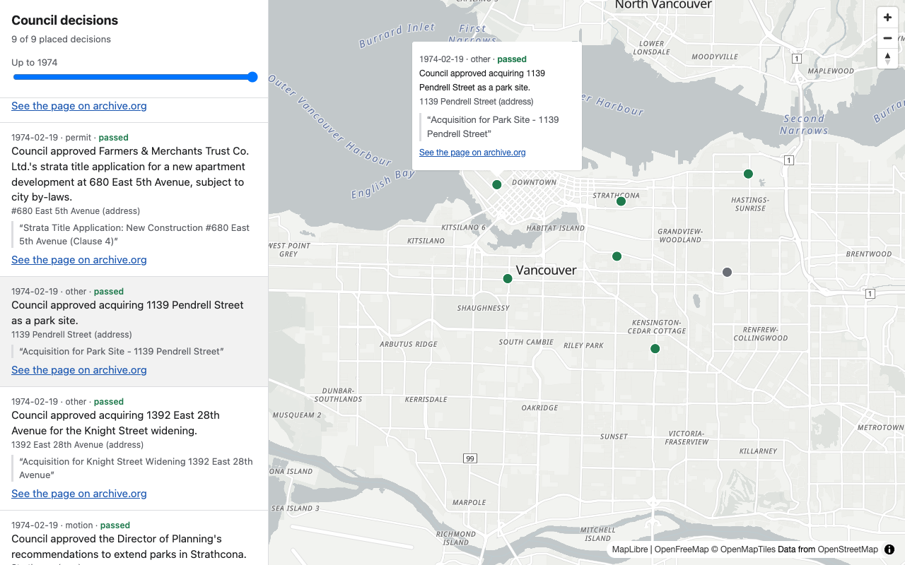
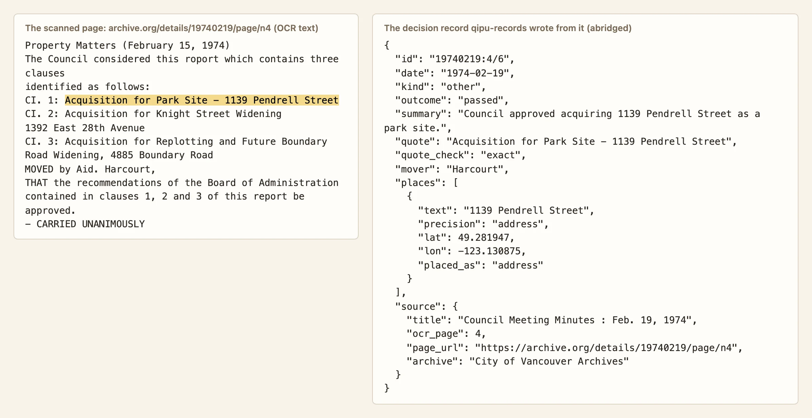

# records

Turns scanned council minutes on the Internet Archive into decision records anyone can check. A language model reads each
page and lists the decisions on it: what was decided, where, when, who moved it and how the vote went, and any amount of
money. Plain code then checks every record before it is published:

- the quote the model gave as evidence must be found on the page;
- the date comes from the meeting header printed in the minutes, not from the model;
- every record links to the exact page in the archive.org viewer, so anyone can check it against the scan;
- the names of private people in sensitive matters (a claim for damages, an illness, welfare) are withheld.

The core uses only the Python standard library. Part of [qipu-vancouver](../../README.md).



One decision record next to the scanned page it came from. The quote is the highlighted line on the page, and `page_url` opens that page on archive.org:



## Quickstart

You need Python 3.11 or newer. From this folder:

```sh
make demo     # reads the sample pages with recorded model answers, checks them, writes build/demo/
make serve    # then open http://localhost:8000/map-preview/
```

`make demo` needs no API key and no network. It runs the same code as a real run on nine pages of 1970s Vancouver minutes in
[examples/vancouver](../../examples/vancouver), with the model's answers replayed from `readings.jsonl`. It prints a summary:

```json
{
 "pages": 9,
 "pages_read": 9,
 "decisions": 32,
 "rejected": 1,
 "dated": 32,
 "fields_corrected": 2,
 "fields_in_conflict": 0,
 "linked_to_page": 32,
 "placed": 9,
 "quote_exact": 31,
 "quote_fuzzy": 1,
 "with_names_withheld": 1
}
```

One of the records it writes, shortened ([docs/data-model.md](../../docs/data-model.md) describes every field):

```json
{
  "id": "19740219:4/6",
  "date": "1974-02-19",
  "date_source": "running head",
  "kind": "other",
  "outcome": "passed",
  "summary": "Council approved acquiring 1139 Pendrell Street as a park site.",
  "quote": "Acquisition for Park Site - 1139 Pendrell Street",
  "quote_check": "exact",
  "mover": "Harcourt",
  "places": [{"text": "1139 Pendrell Street", "precision": "address", "lat": 49.281947, "lon": -123.130875, "placed_as": "address"}],
  "source": {
    "item": "19740219",
    "title": "Council Meeting Minutes : Feb. 19, 1974",
    "page_url": "https://archive.org/details/19740219/page/n4",
    "licence": "http://creativecommons.org/publicdomain/zero/1.0/"
  },
  "reading": {"model": "claude-haiku-5-5", "prompt_version": "v21-db2bcbe8fe"}
}
```

The map preview is a single static page that draws `decisions.geojson`. The full map, with the painted city, is
[packages/viewer](../viewer).

## Reading more minutes

Install the package with the client for the model you want to use:

```sh
python -m venv .venv && . .venv/bin/activate
pip install -e '.[anthropic]'        # or '.[openai]' for an open-weights model behind an OpenAI-compatible server
```

Then fetch some meetings, read them, and build the records. The identifiers of the Vancouver minutes are in the
[City of Vancouver council minutes collection](https://archive.org/details/cityofvancouvercouncilminutes) on archive.org.

```sh
qipu-records fetch --out work/van 19740219 19740226
export ANTHROPIC_API_KEY=...                       # read from the environment only, never stored
qipu-records read --out work/van --max-pages 20
qipu-records gazetteer --out work/vancouver-places.csv
qipu-records build --out work/van --gazetteer work/vancouver-places.csv
```

`read` sends at most `--max-pages` pages to the model (20 by default), whether or not the answers are usable, so a mistake
costs cents. Pages already read are skipped, so you can run it again to continue. With Claude Haiku a page costs about a fifth
of a US cent. `fetch` downloads each file once, about one request a second, and keeps it in `.cache/archive`.

To use an open-weights model instead, serve it with [vLLM](https://docs.vllm.ai) or [Ollama](https://ollama.com), or use a
hosted endpoint, and point `read` at it:

```sh
qipu-records read --out work/van --model Qwen/Qwen3-32B --base-url http://localhost:8000/v1
```

The model must support JSON-schema output. Open models follow the instructions less reliably than Claude: on the pages in
[docs/accuracy.md](../../docs/accuracy.md), the best one tried got 0.84 of San Francisco decisions fully right but 0.49 of
Vancouver's, because it invented vote counts the minutes do not print. Check a sample before trusting a run.

San Francisco's Board of Supervisors is the second worked example (`--city san_francisco`), with the prompt used to read its
Journal of Proceedings from 1906 to 2016. [examples/](examples) has a script that reads one meeting end to end and one that
queries the records.

## How it works

The code is split by stage, in the order the data moves:

| stage | what it does |
|---|---|
| `fetch` | downloads an item's catalogue record and the OCR text of each page from archive.org, once |
| `read` | sends each page to the model, which lists the decisions on it with a quote for each |
| `verify` | finds the quote on the page, dates the item from the meeting header, names the outcome, withholds private names |
| `link` | turns the OCR page number into the page the archive.org viewer shows |
| `map` | places the decision from the address, corner or neighbourhood it names |
| `export` | writes `decisions.jsonl`, `decisions.geojson` for the map, and a summary of every check |

The model is the only step that guesses. Everything after it is deterministic and tested. [ARCHITECTURE.md](ARCHITECTURE.md)
explains each step and why it is there.

## Development

```sh
make install   # .venv with the development tools, pinned with hashes in requirements-dev.txt
make check     # ruff, mypy --strict, unit and integration tests with branch coverage (fails under 90%)
make e2e       # make demo, then the map preview in headless Chromium, with its archive.org links checked
make lock      # re-pin requirements-dev.txt after changing requirements-dev.in
```

## How accurate it is

In short, and with the details and caveats in [docs/accuracy.md](../../docs/accuracy.md):

- **Reading a page.** Against answer keys written by a stronger model, the reader got the item number, the action and the
  vote counts all right for 0.98 of 48 Vancouver decisions and 0.95 of 117 San Francisco ones. Those are development pages,
  partly chosen for interest, and only some of the key was checked by hand; expect less on new material.
- **Published facts.** In a random sample of qipu's San Francisco dataset, built by the same method, 19 of 191 decision facts
  (9.9%, 95% interval 6.5–15.0%) had a flaw, mostly a wrong date, and one was plainly wrong. Another 10 could not have their
  date confirmed and are counted as right. The checker was a model; a human check is prepared but not done.

## Privacy

Records follow the Canadian rule (BC FIPPA): a record 100 years old or more is open, and in a newer one only the name of a
private person in their own sensitive matter (health, assistance, a police or enforcement matter, debts and claims,
discrimination, a child, employee discipline) is replaced with `[name withheld]`. San Francisco uses the same matters with a
75-year cutoff. Officials, firms, payees, delegations and places stay named; the decision, its place, amount and outcome
stay visible.
[docs/privacy.md](../../docs/privacy.md) explains the rule and its limits.

## Limitations

- OCR errors pass through. A misread amount or name in the scan's text will be in the record, though the quote and the page
  link make it easy to see.
- Dates are only as good as the headers. A page without a printed header takes the meeting in progress from the page before,
  which is usually right and sometimes not.
- Only places that still exist as an address, a corner or a neighbourhood are put on the map. Old addresses, landmarks and
  streets named without a number are kept in the record but not placed.
- The privacy rule matches words. It can miss a sensitive matter described in words it does not know, and it withholds an
  official's name when the page gives no role next to it.
- The embargo counts back from the day `build` runs, so the same readings can give different records years apart.
- The gazetteer download covers Vancouver. San Francisco records are built without map points unless you supply a gazetteer.

## Licence

Apache License 2.0, like the rest of [qipu-vancouver](../../LICENSE). The records it produces are dedicated to the public domain
under [CC0 1.0](../../LICENSE-DATA).
