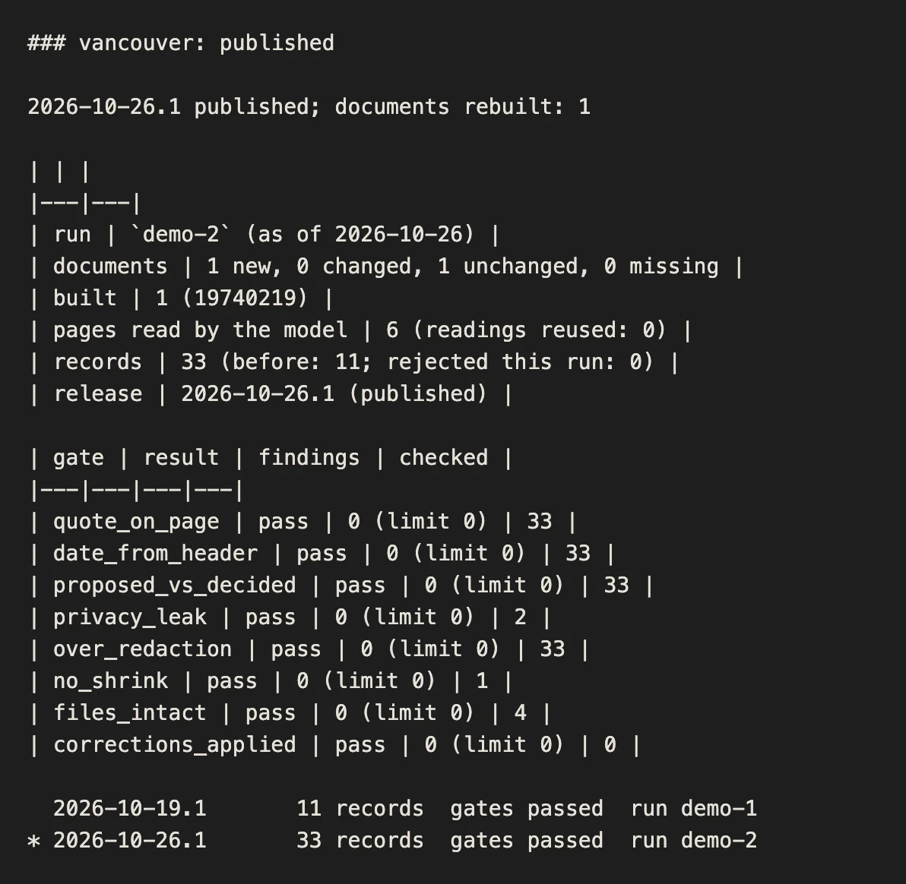

# updates

Keeps the published council records up to date by itself. On a schedule, it lists what the source holds, extracts records
from only the new and changed meetings (with [qipu-records](../records)), checks the whole release against the page text,
publishes it as a new version, and keeps every earlier version for rollback. How it works, how to pause it, how to roll back
and how to add a source: [docs/updates.md](../../docs/updates.md).

The status that `make demo` prints for the second run: what changed, what the model read, the gates and the releases.



## Quickstart

You need Python 3.11 or newer. From this folder:

```sh
make install     # .venv with qipu-records from ../records and the pinned dev tools
make demo        # two scheduled runs a week apart on the Vancouver sample; the second processes only the new meeting
make check       # lint, types, unit and integration tests with coverage (fails under 85%)
make e2e         # the scheduled workflow's run step, executed as GitHub runs it, offline
```

Then, on any config and store:

```
.venv/bin/qipu-updates run       --config ../../examples/vancouver/updates/updates.toml --store /tmp/store
.venv/bin/qipu-updates status    --config ... --store /tmp/store
.venv/bin/qipu-updates releases  --config ... --store /tmp/store
.venv/bin/qipu-updates rollback  --config ... --store /tmp/store --reason "..."
```

## Layout

| module | does |
|---|---|
| `sources/` | lists documents and reads their pages: an archive.org collection, a Legistar calendar, a local mirror |
| `schedule/` | pause, lock, and whether a source is due |
| `incremental/` | the plan (new, changed, unchanged), the working copy that keeps readings of unchanged pages, the call into qipu-records |
| `gates/` | the automatic checks a release must pass before it is published: quote on page, date from header, proposed vs decided, privacy leak, over-redaction, and the release-wide checks |
| `release/` | assembles a release folder, stamps provenance, applies corrections, writes the manifest |
| `publish/` | the store (local folder or any rclone remote), publish, rollback, history |
| `monitor/` | the run report, metrics, and the GitHub issue on failure |
| `loop.py` | one run, start to finish |
| `cli.py` | the `qipu-updates` command |

The one runtime dependency is qipu-records. The scheduled job is [.github/workflows/updates.yml](../../.github/workflows/updates.yml).

## Licence

Apache License 2.0, like the rest of the repository ([LICENSE](LICENSE)). The records it publishes are CC0 1.0
([LICENSE-DATA](../../LICENSE-DATA)).
