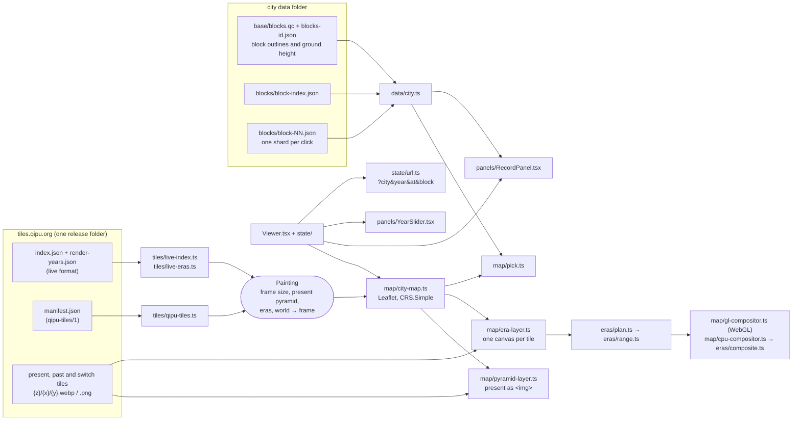

# How the viewer works

The viewer shows a city painted from above, lets a reader move through its past with a slider, and opens the council
record of whatever block they click. It reads three kinds of published files and holds no server of its own.

## One frame for everything

The painting is an oblique bird's-eye view, not a web map: the camera looks north and down, so a building's roof sits up the
picture from its footprint by its height. There is no latitude and longitude on screen. Everything is placed in one frame,
level-0 CSS pixels with y down, and Leaflet's `CRS.Simple` maps that frame to the screen at `2^zoom` pixels per unit, which is
exactly how the pyramid's levels are cut.

Both tile formats are read into one `Painting` (`tiles/painting.ts`): the frame's size, the present pyramid, the eras, and a
function from world metres (x east, y north, height) to the frame. The live qipu.org index states the renderer's camera and
tilt, and `tiles/projection.ts` with `tiles/frame.ts` turn those into that function. A `qipu-tiles/1` manifest states a 2 x 4
matrix, which is used as it is. Nothing past the parsers knows which format it is drawing.

## The past, pixel by pixel

The city is split into areas, each painted at a few key years. Between two key years a switch tile stores, for every pixel, the
date that pixel changes from the earlier picture to the later one (`eras/switch.ts` decodes it; `docs/tiles-format.md` at the
repository root specifies it). So when the slider passes 1959 the freeway appears in the year it was built, not all at once at
the next key year, and a building that burned in 1906 is gone the day it burned.

For each tile on screen and each area over it, `eras/plan.ts` works out the pictures and switch tile the year needs. Before
fetching pictures, the era layer reads the switch tile once and keeps the span of dates over which any of its pixels changes
(`eras/range.ts`). Outside that span the tile shows one picture whole, so only that picture is fetched. Most tiles change over
a few years of a segment that spans decades, so this keeps most views to one image per area per tile.

The compositor then mixes the pictures per pixel. On WebGL a small fragment shader does it for every tile on screen at every
frame of the slider; without WebGL the same arithmetic runs on the CPU (`eras/composite.ts`). The TypeScript is the reference:
the unit tests pin it down and the shader is a line-by-line port. The end-to-end tests read pixels back from both paths.

Era images are fetched at low priority, six at a time, so the present-day tiles, which are plain `` elements, arrive first
and the map is never blank while the past loads.

## Which block was clicked

Blocks are not drawn; they are the unit the record is placed on. `map/pick.ts` places each block's outline in the frame at its
own ground height, so on a hill it sits where the painting shows it. A click is a point in the frame; the block whose outline
contains it wins, and where outlines overlap (a slope seen from the south) the higher one wins, because the camera's ray meets
it first. Building heights are not modelled: on a tall roof a click can land on the block behind. The site's own picker marches
through building solids for that, at the cost of a terrain model and the buildings' heights; this one needs only the blocks.

## Records, in tiers

`data/city.ts` loads the block outlines and the record index at start (a few hundred kB), one shard of records per click, and the
money file only when a panel first asks for it. The outlines and the index are two files built separately and joined by position,
so the loader checks that their ids agree and refuses to start if they do not: a silent off-by-one would put every decision on the
wrong block.

Every row's source link is rebuilt from its citation and a one-letter system code (`data/sources.ts`): a scanned volume's page on
the Internet Archive, a Clerk's PDF at its page, a Legistar meeting, or a URL the row carries itself.

## State and links

`Viewer.tsx` holds the year, the selected block and the view, and `state/url.ts` writes them to the query string, so any view can be
shared: `?city=sf&year=1938&at=95.3,49.2,6.25&block=3531`. A malformed field is dropped rather than failing the page. The map
itself is an imperative object (`createCityMap`) wrapped by one hook, so the map code has no React in it and could sit under
another UI.

## What was left behind

The qipu.org map has more than this package: the 1906 fire's flames and smoke, a water-tone correction between eras, a "not painted
yet" wash outside the painted areas, address search, story cards, films and the three-dimensional engine used on desktops before the
painted tiles. They are tied to the site or to one city, and the package is the mechanism a second city or another archive would
reuse: tiles, eras, picking and records.
