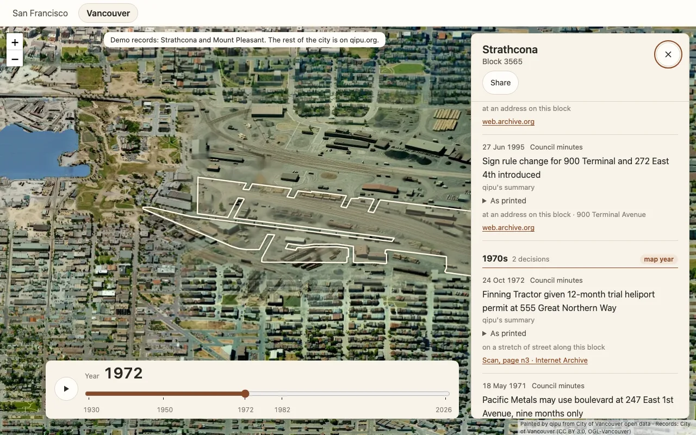
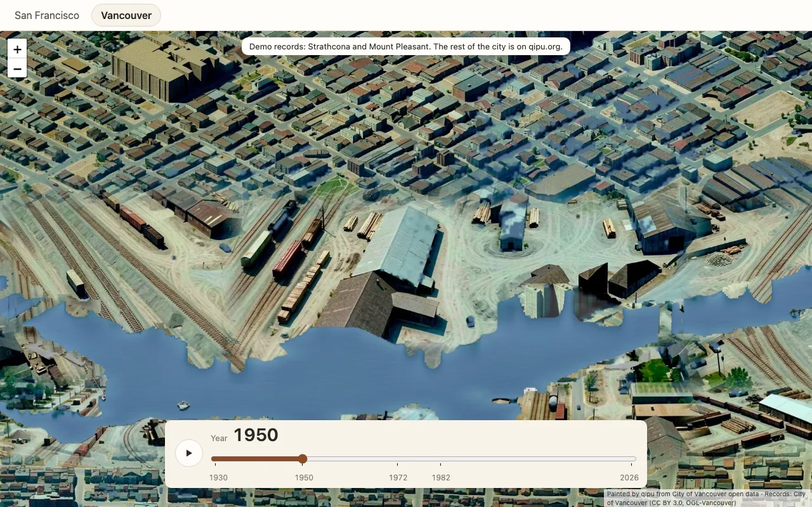

# viewer

The web map behind [qipu.org](https://www.qipu.org/vancouver): a city painted from above, a year slider that rebuilds it as it
stood in that year, and, on any block, what the city council decided there, with a link to the page of the minutes that says so.

It reads the painted tiles that [`packages/map-pipeline`](../map-pipeline) writes, and decision records by block in one of
two forms: the block shards qipu.org publishes (format in [docs/data-model.md](../../docs/data-model.md#block-shards)), or the
`decisions.jsonl` that [`packages/records`](../records) writes, which the viewer places on the city's blocks itself
(`src/data/decisions.ts`). It runs in the browser and needs no server of its own.



## Quickstart

You need Node 20 or newer. From this folder:

```sh
make install    # npm ci: exactly the versions in package-lock.json
make demo       # the demo app at http://localhost:5173, opening on Strathcona in 1972 with one block's decisions open
```

The demo draws the live tiles from tiles.qipu.org (read only) and the block records from a sample in
[`demo/public/sample`](demo/public/sample): the Mission, Haight-Ashbury and Chinatown in San Francisco, Strathcona and Mount
Pleasant in Vancouver. Try:

- `?city=sf&year=1906&at=95.3,49.2,6.25&block=3531`: the Mission the summer after the fire, one block's record open
- `?city=vancouver&year=1950&at=85,40,6.5`: the False Creek flats in 1950, rail yards and sawmills
- `?gl=0`: the same pictures drawn without WebGL
- `?tiles=<release folder>`: a release written by the map pipeline (`qipu-tiles/1`), over Vancouver's records
- `?city=vancouver&decisions=sample&year=1974&at=85,40,6`: Vancouver's records read from the `decisions.jsonl` of
  `make -C packages/records demo` (bundled as `demo/public/sample/vancouver/decisions.jsonl`; `make records-sample` refreshes
  it), placed on the blocks in the browser; `?decisions=<url>` reads any other one, such as a packages/updates release



## What it does

- **The painted city, at any zoom.** Tiles are 512 px images shown at 256 CSS px, so they are sharp on phones; a 1x screen loads
  one level coarser and gets the same picture for a quarter of the bytes. Tiles a pyramid does not have are never requested.
- **The past, one building at a time.** Between two painted years a switch map gives each pixel the date it changes, so dragging
  the slider through 1906 shows the fire burning block by block, and a building appears in the year it was built rather than at the
  next painted year. Play runs the years forward.
- **The record of a block.** A click or tap opens the block's decisions, grouped by decade, newest first, the slider's decade
  marked. Each one shows the record's own words (or qipu's plain-English reading of them, labelled as such, with the printed text
  one click away), how precisely it was placed (named the block, an address on it, a stretch of street), any amount, and a link to
  the page of the scan, the Clerk's PDF, or the open-data row it came from. Places on the block (a library, a park) show the money
  the city's files tie to them.
- **Links that reopen the view.** The city, year, view and open block are kept in the address bar
  (`?city=sf&year=1938&at=95.3,49.2,6.25&block=3531`); Share copies it, or opens the phone's share sheet.
- **Phones.** Pinch and drag; the record is a bottom sheet above the slider; the zoom buttons give way to pinching.

## How it works

Briefly: both tile formats are read into one model, a `Painting`, placed in one pixel frame; Leaflet shows it with
`CRS.Simple`; the past is drawn per pixel by a WebGL compositor (with a CPU fallback that runs the same arithmetic); blocks are
picked by placing their outlines at their own ground height; records load one shard per click, or come from a records
`decisions.jsonl` placed on the blocks at load. [ARCHITECTURE.md](ARCHITECTURE.md)
has the diagram and the reasoning, and [docs/tiles-format.md](../../docs/tiles-format.md) the tile format agreed with the map
pipeline.

```
src/
  Viewer.tsx        the composition root: map, slider, panel, URL state
  config.ts         the two cities qipu.org serves, as data, with their public endpoints
  tiles/            both tile formats into one Painting; frame and projection maths; masks; URLs
  eras/             the era model, per-pixel switch decoding, tile plans, the CPU compositor
  map/              Leaflet layers, the WebGL compositor, the tile image cache, the block picker
  data/             QCT1 chunks, block outlines, record shards, source links, strict JSON readers
  state/            URL state and the React hooks around the map
  panels/           the record panel, decision list, source links, places, year slider, share
demo/               the demo app and its sample records
e2e/                Playwright tests against the demo, with tiles served from fixtures
```

## Using it in another app

```tsx
import { Viewer, SAN_FRANCISCO, readViewState, withDataBase } from "@qipu/viewer";
import "@qipu/viewer/style.css";

<Viewer city={withDataBase(SAN_FRANCISCO, "/data/us/sf/city")} initial={readViewState(location.search)} syncUrl />;
```

The host gives the viewer a positioned box to fill. Under the component, `createCityMap()` is the map alone, framework-free:
give it an element, a `Painting` from `loadPainting()`, and callbacks for picks and moves.

A city is a `CityConfig` ([src/config.ts](src/config.ts)): where its tiles are and in which format, where its data folder is, how
to name its record series, and a credit line. Nothing else in `src/` names a city.

| reads                                                                                                                 | from                   | when                               |
| --------------------------------------------------------------------------------------------------------------------- | ---------------------- | ---------------------------------- |
| `render/index.json`, `_preview_eras/render-years.json` (live) or `manifest.json` (`qipu-tiles/1`)                     | the tile release       | at start                           |
| `{z}/{x}/{y}.webp` present tiles; past and switch tiles                                                               | the tile release       | as the view and year need them     |
| `manifest.json` (projection, neighbourhood names), `base/blocks.qc`, `base/blocks-id.json`, `blocks/block-index.json` | the city's data folder | at start                           |
| `blocks/block-NN.json`, `blocks/block-money.json`                                                                     | the city's data folder | on the first click that needs them |

qipu.org serves the data folders without CORS headers, so a page on another origin cannot read them; the demo uses the sample.
To read the full records during development, `QIPU_DATA_ORIGIN=https://www.qipu.org VITE_QIPU_DATA=live npm run demo` proxies
`/data` through the dev server.

## Tests

```sh
make check      # ESLint (type-aware, strict), Prettier, tsc --strict, Vitest with coverage
make e2e        # Playwright: the demo in Chromium on a desktop and a Pixel 7
```

- **Unit** (Vitest): tile frame and level maths, masks in both bit orders, both manifest formats, the switch decoding and the CPU
  compositor pixel by pixel, the switch-range narrowing, QCT1 decoding and its CRC, block outlines, record and money parsing,
  source links for every record system, URL state.
- **Component** (Testing Library, jsdom): the record panel and its states, decade grouping, the as-printed disclosure, source
  links, places and money, the slider and Play, Share; the `Viewer` with the map mocked; the era layer, present layer, map and
  tile cache against fakes of the GPU and the network.
- **End to end** (Playwright): the demo loads; moving the slider redraws a quarter, checked by reading back the era layer's
  pixels, with WebGL and without; Play stops at the present; a click or tap opens a block's record and its source link opens the
  scan in a new tab; a shared link reopens the block; a failed tile server says so; the first view stays inside its tile budget.
  Tiles are served from fixtures, so CI never reaches tiles.qipu.org.

The unit and component tests run under a coverage floor (85 % lines, 75 % branches, set in `vitest.config.ts`), and the end-to-end tests run on each of two devices.

Headless Chromium renders WebGL with SwiftShader, which is enough to check the shader's output but not how it looks or how fast
it runs on a real GPU. Before a release, check by hand on a laptop and a phone: drag the slider across 1906 over the Mission and
across 1959 over the Western Addition and watch for seams between tiles, for a quarter's edge showing as a box, and for stutter;
pinch-zoom past the deepest level; open a block on a hill (Twin Peaks, Bernal Heights) and check the outline sits on it; rotate
the phone with the panel open.

## Performance

Measured on the production build, San Francisco, a 1440 x 900 window at 2x and a Pixel 7:

| view                         | requests             | bytes           |
| ---------------------------- | -------------------- | --------------- |
| whole city, today, desktop   | 2 JSON + 15 tiles    | 11 kB + 1.1 MB  |
| whole city, today, phone     | 2 JSON + 2 tiles     | 11 kB + 71 kB   |
| the Mission in 1906, desktop | 53 present + 180 era | 3.8 MB + 9.2 MB |
| the Mission in 1906, phone   | 18 present + 72 era  | 1.4 MB + 2.9 MB |

The budget the tests hold: the first view asks for no more present-day tiles than its viewport needs and for no era tile at the
present; with tiles served locally it is drawn within 2.5 s. Era tiles go at low priority, six at a time, so the present arrives
first and the map is never blank while the past loads. A pass whose tile is not changing at the year loads one picture rather
than three or four. Decoded era images are capped (400 on a desktop, 160 on a phone) and so are GPU textures (128).

## Accessibility

The map has a label and Leaflet's keyboard controls; the slider is a native range input with the year as its value text and a
live `<output>`; Play is a toggle button; the panel is a labelled region that takes focus on open, closes on Escape and returns
focus where it was; links say where they go and that they open a new tab; ESLint runs `jsx-a11y` in strict mode.

## Limits

- The picker places blocks at ground height and ignores buildings, so on a tall roof a click can land on the block behind.
- qipu.org's map does more than this: the 1906 fire's flames and smoke, a water-tone correction between eras, address search,
  stories and films. They are tied to the site or to one city and stayed there.
- Text is English only.

## Licence

Code: Apache-2.0 ([LICENSE](LICENSE)), like the rest of the repository. The sample records are described, with their licences, in
[demo/public/sample/README.md](demo/public/sample/README.md).
